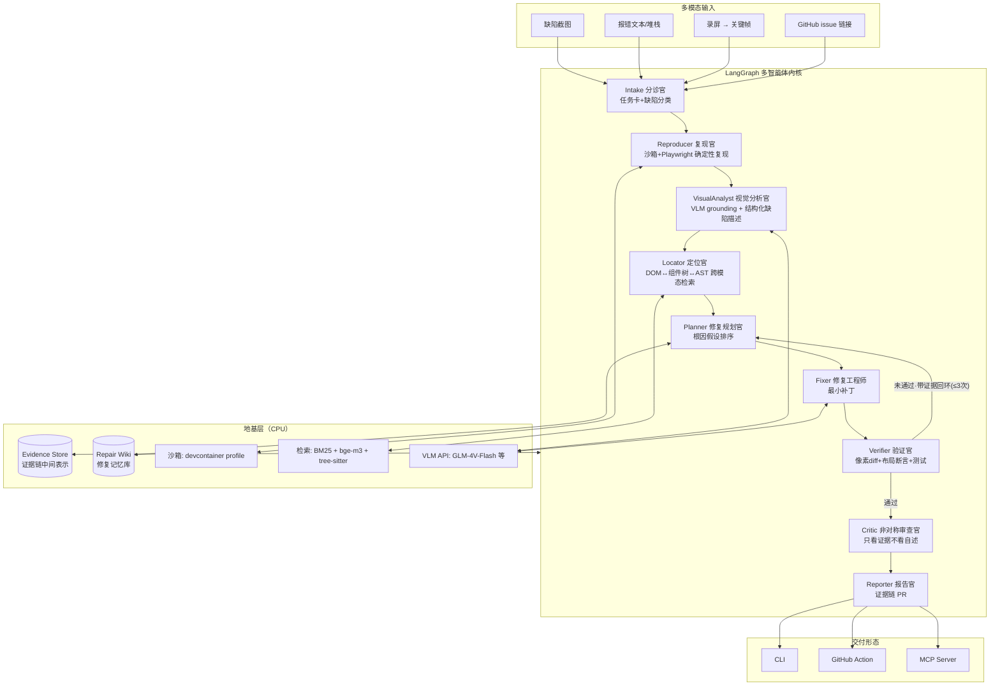

# BugLens 项目策划报告（Project Blueprint）

> **产品一句话**：BugLens — 从一张报错截图到一条可合并的修复 PR：证据链驱动的多模态多智能体 UI 缺陷修复系统。
>
> | 项 | 值 |
> |---|---|
> | 报告日期 | 2026-10-28 |
> | 版本 | v1.1（2026-10-28 深度核勘修订：竞品表述、学术空白窄口径化、投稿日历更正，修订依据与完整证伪记录见 [DEEP_DIVE_DECISION.md](DEEP_DIVE_DECISION.md)） |
> | 作者 | 个人开发者（学生，求职导向） |
> | 目标仓库 | `buglens`（本文件夹，独立新项目） |
> | 技术底座 | LangGraph（多智能体编排）+ 开源多模态模型 API + Playwright |
> | 硬件约束 | **CPU-only**，零 GPU 依赖 |
> | 开源许可 | Apache-2.0 |
> | 核心目标 | GitHub 日/周趋势榜 + CCF-A 级学术产出 + 可持续商业化 |

---

## 0. 执行摘要（TL;DR）

**结论：在调研的 6 个候选方向中，"视觉缺陷修复智能体 BugLens"以 4.80/5 的加权得分显著领先（第二名 3.90），建议立项。**

三条决定性依据（均来自 2026-10-28 实时检索，来源见附录 A）：

1. **开源生态无有牵引力的占用者，商业付费已验证**。深查（9 组关键词 + 中文生态 + 插件生态）发现：该闭环仅存在 6+ 个 0–6★ 的黑客松级仓库（ReproSight、visual-bug-hunter、BugPack 等）与 GUIRepair 论文官方仓库（0★），赛道占用度约 30%，无一获得市场验证；商业对手 Devin（$20/月起）、CodeRabbit（$24/人/月）、Google Antigravity 都在向"截图定位+自主修复"收敛但只做了闭环的零件——说明**需求真实、付费意愿存在、工程位空缺**。同时 Lost Pixel（视觉回归）2026-04 归档、Argos 转型，开源视觉测试出现真空期。
2. **学术空白恰好可被个人开发者填补（窄口径，v1.1 核勘收窄）**。该方向研究火热：ASE 2025 的 GUIRepair 在 SWE-bench Multimodal 仅解 175/517，2026 年 SOTA VisualRepair 也只到 196/517；且现有全部方法的**最终裁决仍是 LLM 主观判断**、修复管线内"LLM 生成代码近似复现"的保真度无人度量、**行级视觉定位 ground truth 完全缺失**（深查确认最结实空白）。做"修复循环内可执行视觉 oracle + 管线内复现保真度指标 + 行级标注的跨框架基准"是纯评测型贡献，**无需训练、API 推理即可、CPU 完全可行**，直指 ASE 2027 / ICSE 2028 与 NeurIPS Datasets & Benchmarks（均为 CCF-A）。
3. **增长打法有成熟模板可抄**。browser-use（119k★）、OpenManus（59k★，首日 3k）验证过的最小增长包：README 首屏 GIF + 一行安装 + MCP 兼容形态 + 发布日 Show HN/Reddit/X/掘金同日集中导流 + 中英双语文档。模型侧 GLM-4V-Flash **免费**、DeepSeek 视觉 $0.15/百万 token 起，个人月成本可压在几十元人民币级。

**风险最高的三件事**：复现环境多样性（对策：devcontainer profile + 适配器插件化）、大厂跟进（对策：以 benchmark 与证据链协议先占位、快速社区化）、学术撞车（对策：benchmark 先行 arXiv 占坑）。详见第 9 节风险登记册。

---

## 1. 调研综述（数据截至 2026-10-28）

### 1.1 高星 Agent 项目的增长规律

| 项目 | Star（约） | 爆火原因 |
|---|---|---|
| [browser-use](https://github.com/browser-use/browser-use) | 119k | "AI 自己开浏览器"首屏 GIF + `pip install` 一行装 + YC 背书推特传播 |
| [awesome-mcp-servers](https://github.com/punkpeye/awesome-mcp-servers) | 97k | 纯 MCP 清单站 97k——**MCP 兼容即自带分发渠道** |
| [OpenHands](https://github.com/All-Hands-AI/OpenHands) | 92k | 开源版 Devin，吃掉邀请制挫败情绪 |
| [screenshot-to-code](https://github.com/abi/screenshot-to-code) | 80.8k | 截图→代码，**证明"视觉×前端"是流量密码**（但它只生成、不修 bug） |
| [MetaGPT](https://github.com/geekan/MetaGPT) | 71k | 多智能体角色分工叙事 |
| [OpenManus](https://github.com/FoundationAgents/OpenManus) | 59k | 蹭 Manus 邀请制时间窗，首日 3k★，双语 README |
| [LangGraph](https://github.com/langchain-ai/langgraph) | 44k | MIT，v1.2.18（2026-10-26），月下载 3450 万，**有状态多智能体事实标准** |
| [playwright-mcp](https://github.com/microsoft/playwright-mcp) | 38.8k | 视觉智能体的"眼睛"，微软官方 |
| [SWE-agent](https://github.com/SWE-agent/SWE-agent) | 21k | 学术系 issue 自动修复（NeurIPS 2024） |
| [UI-TARS](https://github.com/bytedance/UI-TARS) | 12k | 字节原生 GUI 多模态模型，证明赛道为巨头级（个人勿做模型，做应用） |

**可复制的增长共性**：① README 首屏动图 + 一行安装；② MCP 插件化蹭生态分发；③ 发布日 24 小时内 Show HN + Reddit + X 集中引爆（trending 按 star **速度**而非总量排名，日榜经验值约 80–100★/日有机会、500+/24h 较稳，周榜需持续低千级增量）；④ 中英双语同时吃 HN 与中文社区两个流量池；⑤ good first issue + 快速响应促成贡献者裂变；⑥ 周一/周二发布，避开周末。

### 1.2 已饱和的红海品类（本项目避开）

| 品类 | 证据 |
|---|---|
| Deep Research 复刻 | OpenAI 发布后 HF 24h 内复刻、随后"无数开源克隆"，2026 年新出同类仅 ~4.1k★，增量见顶 |
| 通用 Chat UI | open-webui 157k、lobe-chat 84k 锁死入口 |
| 知识库 RAG / 工作流平台 | Dify 160k 一家通吃；个人新做通用 RAG 无差异点 |
| 通用多智能体框架本身 | LangGraph/CrewAI/AutoGen/MetaGPT 五强固化，"做框架不如做框架上的垂直应用" |

### 1.3 学术前沿与空白（arXiv / 顶会 2025–2026）

**截图→修复方向已有工作**（必须尊重，避免"重新发明"）：

- **SWE-bench Multimodal**（[2410.03859](https://arxiv.org/abs/2410.03859)）：617 个带截图的 JS/React issue，该方向事实基准；
- **GUIRepair / Seeing is Fixing**（ASE 2025, [2506.16136](https://arxiv.org/abs/2506.16136)）：最接近完整闭环——截图→LLM 生成复现代码→补丁→渲染验证；深查精读确认其复现为 LLM 生成代码近似（环境人工搭建）、最终裁决为 LLM 主观判断；o4-mini 解 175/517，官方仓库 0★；
- VisualRepair（[2607.14075](https://arxiv.org/abs/2607.14075)，CUHK，当前 SOTA 196/517，区域级聚焦，代码未放）、SVRepair（[2602.06090](https://arxiv.org/abs/2602.06090)，蚂蚁 codefuse，微调开源 VLM 达 186/517，[代码已开源](https://github.com/codefuse-ai/CodeFuse-SVR)）、ReBug（[2608.03598](https://arxiv.org/abs/2608.03598)，真实浏览器复现，量化复现成功率 RSR 49.96%，仅复现不修复）、GALA（[2604.08089](https://arxiv.org/abs/2604.08089)）、RepoRepair（[2603.01048](https://arxiv.org/abs/2603.01048)）——2026 年密集跟进，均未提供行级定位标注，最终验证仍靠 LLM 主观判断。

**四项窄口径空白（v1.1 深查核勘后收窄；对应宽口径已被部分工作关闭，须按窄口径表述）**：

1. **修复循环内无可执行视觉验证 oracle**——SWE-bench M 已有 69/617 实例在测试中使用 Puppeteer/Pixelmatch 像素比对，SWE-PolyVision（[2609.29754](https://arxiv.org/abs/2609.29754)）已是可执行多模态基准（聚焦跨图像溯因推理）；但现有修复方法（GUIRepair/VisualRepair/SVRepair）的**最终裁决仍是 LLM 主观判断**，修复循环内统一、全量的可执行 oracle 缺失；
2. **修复管线内的复现保真度未被度量**——ReBug 已量化真实浏览器复现成功率 49.96%（仅复现、不修复）；GUIRepair 式"LLM 生成代码近似复现"在**修复管线内**的保真度仍无人度量；
3. **无行级视觉故障定位 ground truth（最结实空白，完全成立）**——SWE-bench M 的 17 个仓库全部为 JS/TS（非"仅 React"但纯 JS 生态），仅有文件级 F1 分析；2026 年全部后续工作（含 SWE-PolyVision）均未提供行级标注；移动端 H5/Flutter Web/桌面端视觉修复零覆盖；
4. **免费开源模型路线的可达性与差距未被系统评估**——SVRepair 已用微调开源 VLM 达 186/517（代码开源），"全闭源"表述不再成立；但"免费 API 开源模型 vs 闭源"的系统差距评测与可复现管线仍缺失。

**多智能体协作的开放问题（2026 仍在热炒，BugLens 直接借力）**：

- Verifier 确认偏置与"假共识"：MARCH（[2603.24579](https://arxiv.org/abs/2603.24579)）、Adversarial Review（[2608.18167](https://arxiv.org/abs/2608.18167)）、OS-Oracle（[2512.16295](https://arxiv.org/abs/2512.16295)）；
- 证据链可审计决策缺统一范式：CLEAR（[2608.03134](https://arxiv.org/abs/2608.03134)）、RIME（[2609.34438](https://arxiv.org/abs/2609.34438)）；
- Self-evolving memory 的稳定性-可塑性：2026-10 连发多篇 survey（[2610.25858](https://arxiv.org/abs/2610.25858)、[2610.19366](https://arxiv.org/abs/2610.19366)）。

**MCP 方向对照**（评估候选 2 时的依据）：安全审计已卷（VIPER-MCP 扫 39,884 仓库报 106 个 0-day，[2605.21392](https://arxiv.org/abs/2605.21392)），但"server 行为契约测试/回归"无专门工作——这是候选 2 的立足点，但天花板低于候选 1（见 3.3）。

### 1.4 竞品真空地带（商业对手验证付费意愿）

| 类别 | 玩家 | 对 BugLens 的启示 |
|---|---|---|
| 闭源修复 agent | Devin $2.25/ACU、$20/月起；CodeRabbit 免费 75 PR/月、$24/人/月；Factory 企业价 | 截图定位+自主修复是各家核心卖点 → 付费意愿已验证 |
| 开源截图修复 | **不存在**（GitHub 搜索 0 结果） | 空位 |
| 开源视觉回归 | Lost Pixel 1.68k★ **2026-04 归档**；Argos 651★ 转型"AI agents 的视觉测试" | 真空期 + Argos 的转向佐证赛道方向 |
| 开源维护者工具 | CodeTriage 1.47k★ 停滞；Nuxt 官方维护者自用 carpenter 76★ | 维护者是真实刚需人群，但无千星统治者 |

### 1.5 CPU-only 技术底座可行性（2026-10 报价，约值）

| 组件 | 选择 | 成本 |
|---|---|---|
| 视觉推理（VLM） | 智谱 **GLM-4V-Flash：免费**；GLM-4.5V ¥2/百万输入 | 0 起 |
| 备选 VLM/LLM | DeepSeek flash（支持 Vision）$0.15–0.30/百万输入（错峰半价）；阿里 qwen3-vl-plus ≤32K 档约 $0.2/百万；GLM-4.5-Flash 文本免费 | 极低 |
| 本地嵌入 | bge-m3（FlagEmbedding，12.3k★）CPU 实时可用 | 0 |
| 本地 VLM 兜底 | moondream（2B，ONNX CPU 可跑但慢）仅作离线降级 | 0 |
| 浏览器自动化 | Playwright headless Chromium | 0 |
| 编排 | LangGraph MIT | 0 |

**结论：纯 CPU 单人方案 = API 做 VLM 推理 + 本地 bge-m3 检索 + Playwright 复现，月成本几十元级，完全可行。**

---

## 2. 目标人群与痛点

**主人群：前端 / 全栈 / Web 应用开发者（GitHub 上最大的开发者群体）+ 开源仓库维护者。**

| 画像 | 痛点场景 | 频次 | BugLens 价值 |
|---|---|---|---|
| 前端开发者（主） | 用户/QA 甩来一张截图："界面坏了"。缺环境信息、缺报错、要自己猜在哪、复现半天 | 每周数次 | 截图直接→定位→修复→验证，省去复现与定位两个最耗时环节 |
| 开源维护者 | issue 里只有截图没有复现步骤；stale PR 无人验证视觉影响 | 每个 repo 持续发生 | Issue 回复截图即自动尝试修复，PR 自带视觉证据链 |
| 学生/求职者 | 面试作业/毕设项目的视觉 bug 自己看不出根因 | 高频 | "AI 同学"给出根因解释与教学式修复报告 |
| QA/测试工程师 | 视觉回归工具（Lost Pixel 已死）缺失 | 每次发版 | 修复与回归验证二合一 |

**痛点量化锚点**：Devin/CodeRabbit/Cursor 全部把"截图→定位→修复"当卖点定价 $20–24/月起，说明企业愿意为"每省 1 小时调试"付费；而开源世界零供给——这就是 BugLens 的位置。

**时代风口属性**：自主软件工程（autonomous SWE）被广泛视为通向 AGI/ASI 的标志性能力赛道（SWE-bench 系列是各大实验室的头号宣传位）；BugLens 攻克的"机器如何用眼睛验证自己的修改"是任何自主智能体（含未来 RSI/SI 场景）都绕不开的**可验证性**基石——这让项目具备长期叙事而非一阵风。

---

## 3. 候选方案全景与评分

### 3.1 六个候选

| # | 候选 | 一句话定义 | 关键依据 |
|---|---|---|---|
| **C1** | **BugLens — 视觉缺陷修复智能体**（主推） | 截图→复现→定位→修复→像素级验证→证据链 PR | 开源零竞品；学术三空白；GPU 不需要 |
| C2 | MCPForge — MCP server 行为契约测试工厂 | 从 OpenAPI/描述自动生成 MCP server + 回归测试，CI 插件 | 契约测试研究为空；但生成器层碎片化、受众窄于 C1 |
| C3 | PR-Resurrector — stale PR/issue 复活急诊室 | 多智能体分诊、去重、复活陈旧 PR | 无千星统治者、维护者刚需；但演示视觉冲击弱、增长天花板低 |
| C4 | AgentArena — 多智能体评测竞技场 | 让多个 agent 框架同任务竞技并自动评测 | 基建重、需要持续算力跑评测、个人难维护、变现弱 |
| C5 | DeepResearch-X — 深度研究复刻 | 开源 deep research agent | 红海：增量见顶，2026 新品仅 ~4.1k★ |
| C6 | RepoWiki-Lite — 仓库活维基 | 代码库自动问答/文档 | 与本工作区既有项目定位重叠（利益冲突），且 Dify/RAG 红海 |

### 3.2 加权评分矩阵（1–5 分；权重按"求职+涨星+学术"目标设定）

| 维度 | 权重 | C1 BugLens | C2 MCPForge | C3 PR-Res | C4 Arena | C5 DR-X | C6 RepoWiki |
|---|---|---|---|---|---|---|---|
| GitHub 受众规模与密度 | 15% | **5** | 4 | 3 | 3 | 5 | 4 |
| 视觉传播力（GIF 化） | 10% | **5** | 3 | 2 | 3 | 3 | 3 |
| 痛点强度 × 频次 | 15% | **5** | 4 | 4 | 2 | 3 | 4 |
| CCF-A 创新空间 | 15% | **5** | 4 | 3 | 4 | 1 | 2 |
| CPU-only 可行性 | 10% | **5** | 5 | 5 | 3 | 4 | 5 |
| 单人可维护性 | 10% | 4 | 4 | 4 | 2 | 3 | 4 |
| 竞争蓝海度 | 15% | **5** | 4 | 5 | 3 | 1 | 1 |
| 商业变现路径 | 10% | 4 | 3 | 3 | 2 | 2 | 3 |
| **加权总分** | | **4.80** | 3.90 | 3.65 | 2.80 | 2.70 | 3.15 |

### 3.3 淘汰/降级理由明细

- **C2 MCPForge（最强备胎，3.90）**：研究空白真实（描述-行为不一致率 13%，[2602.03580](https://arxiv.org/abs/2602.03580)），但生成器层已有 fastmcp 28.2k★ 锁死框架心智，"再造工厂"叙事易被官方 SDK 吸收；受众（MCP server 作者）远小于"所有写界面的人"。**保留为 BugLens 生态内的子模块可能性**（BugLens 自身可发布为 MCP server）。
- **C3（3.65）**：需求信号真实（Nuxt 维护者自研自用），但 demo 不直观、star 传播力弱，适合作为 BugLens v2 的"维护者模式"功能而非独立项目。
- **C4（2.80）**：需要持续跑评测的算力与中立性背书，个人无力承担，弃。
- **C5（2.70）**：红海证据充分（1.2 节），弃。
- **C6（3.15）**：与作者在本工作区的既有项目定位重叠，为避免自我竞争与利益冲突**主动排除**（本报告未读取该项目任何内容）；且通用 RAG 属红海。

---

## 4. 主推方案：BugLens 产品深度设计

### 4.1 产品定义与 Demo 剧本

**Slogan**：*See it. Reproduce it. Fix it. Prove it.*（看得见 → 复现得了 → 修得好 → 证得明）

**首屏 Demo 剧本（发布日 GIF，30 秒）**：

```
$ buglens fix --shot broken-checkout.png --repo .

🔍 Reproducer   在沙箱拉起 dev server，Playwright 复现成功（截图/DOM/console 已捕获）
👁 VisualAnalyst 异常区域: [x=612,y=340,w=280,h=96] "支付按钮被导航栏遮挡，z-index 冲突"
📍 Locator      DOM path → <PayButton/> → src/components/checkout/PayButton.tsx:87  (置信度 0.93)
🛠 Fixer         生成最小补丁 (+2 −1)
✅ Verifier      像素 diff 12,304→9 px ✓  布局断言通过 ✓  既有测试 34/34 ✓
📝 Reporter      PR #182 已创建 · 附 before/after GIF 与完整证据链
```

**三种使用形态**（对应三类用户）：

1. **CLI**（开发者本地）：`uvx buglens fix --shot bug.png --repo .`
2. **GitHub Action / Issue 机器人**（维护者）：issue 里回复 `/buglens 截图`，机器人提 PR；
3. **MCP server 形态**（蹭 97k★ awesome-mcp-servers 生态 + 魔搭 MCP 广场 1500+ 服务分发）：任何 agent（Claude/Trae/GLM 等）可把 BugLens 当"眼睛+扳手"调用。

### 4.2 核心创新点（逐条对应 1.3 节学术空白）

| # | 创新 | 对应空白 | 学术/工程双重价值 |
|---|---|---|---|
| 1 | **可执行视觉验证 oracle**：修复验证 = 确定性渲染 diff（像素 + SSIM + 布局盒断言 + 既有测试），而非 LLM 主观判断 | 空白 1 | 修复循环内首个全量可复算的视觉判定器；工程上是"可信"卖点 |
| 2 | **确定性复现 + 管线内复现保真度指标**：沙箱内拉起真实仓库复现（非 LLM 生成代码近似），并量化修复管线内的复现保真度 | 空白 2 | 基准新指标（窄口径）；工程上是 debug 可信前提 |
| 3 | **证据链中间表示（Evidence IR）**：每一步断言（截图区域↔DOM 节点↔代码行↔补丁↔渲染证据）显式挂接、可点开审计 | 多智能体开放问题 | 可审阅性=产品差异；研究上回应"evidence-grounded 决策无统一范式" |
| 4 | **非对称 Critic**：审查智能体只看证据、不看 Fixer 自述，天然对抗确认偏置/假共识 | 多智能体开放问题 | 直接借用 2026 热点叙事，消融实验现成 |
| 5 | **开源模型可达性评测**：全管线跑 GLM/DeepSeek/Qwen 免费或低价档 | 空白 4 | 免费 API 开源模型 vs 闭源的系统差距数据（SVRepair 用微调开源 VLM，免费 API 路线无评测），社区传播点 |
| 6 | **修复知识库（Repair Wiki，self-evolving memory）**：每次修复沉淀为结构化 wiki 条目（症状→根因→补丁模式），社区可贡献、跨项目复用 | self-evolving memory 热点 | 数据飞轮：用得越多越聪明；也是"wiki"要素的落点 |

### 4.3 系统架构



### 4.4 LangGraph 状态机设计（设计草图）

```python
# 设计草图（非实现），展示状态与条件边
class Evidence(BaseModel):
    kind: Literal["screenshot", "dom", "code_span", "diff", "render_diff", "test_run"]
    artifact: str          # 指向 Evidence Store 的内容寻址引用
    claim: str             # 该证据支撑的断言
    produced_by: str       # 产生该证据的智能体节点

class BugLensState(TypedDict):
    task_card: TaskCard                      # 输入归一化后的任务卡
    evidence: Annotated[list[Evidence], add] # 证据链（只增不改，天然可审计）
    repro: ReproResult | None                # 复现结果 + reproduction 评分
    visual_report: VisualReport | None       # bbox + 结构化缺陷描述
    candidates: list[CodeLocation]           # 行级候选（带置信度）
    hypotheses: list[Hypothesis]             # 根因假设栈
    patch: Patch | None
    verdict: Verdict | None                  # oracle 判定 + 全量证据
    retries: int                             # 回环计数，上限 3

graph = StateGraph(BugLensState)
# 节点: intake → reproducer → visual_analyst → locator → planner
#       → fixer → verifier → critic → reporter
# 条件边: verifier 失败且 retries<3 → planner（携带失败证据）
#         critic 否决 → planner（携带否决理由）
#         全部通过 → reporter（END）
```

**多智能体设计原则**：每类智能体 = 独立提示词 + 独立可单测的纯函数（输入 state 切片，输出 state 增量）——**可单测、可替换、可评测**，这是"可审阅可管理"的工程落点，也是消融实验的单位。

### 4.5 技术栈选型与理由（CPU-only 约束下的每项决策）

| 层 | 选型 | 理由 |
|---|---|---|
| 语言 | Python 3.12+ + `uv` 包管理 | 生态（Playwright/tree-sitter/LangGraph）+ 锁文件快且干净 |
| 编排 | **LangGraph ≥1.2（MIT）** | 用户点名要求；有状态图 + 持久化 + 时间旅行调试，正适合"证据链回放"；（备选 OpenAI Agents SDK 30.4k★ 更轻，作为附录记录不采用的原因：图状态机与回环控制更贴合） |
| 视觉推理 | GLM-4V-Flash（主，免费）→ DeepSeek flash / qwen3-vl-plus（备）→ moondream ONNX（离线兜底） | 三级降级保证"永远能跑"；同时天然适配智谱/华为社区渠道 |
| 文本推理 | GLM-4.5-Flash（免费）/ DeepSeek | 补丁生成与规划 |
| 复现 | Playwright + devcontainer profile | 确定性环境（固定视口、时区、种子、禁动画）是复现保真度的前提 |
| 验证 oracle | 自研：像素 diff（阈值化）+ SSIM + 布局盒断言 + Playwright 截图对齐 + 既有测试 | 确定性、可复算——本项目学术核心 |
| 检索 | BM25（rank-bm25）+ bge-m3（本地 CPU 嵌入）+ tree-sitter AST 切片 | 混合检索提行级定位精度；零 GPU |
| 沙箱 | Docker devcontainer（CI 与本地一致） | 用户代码不可信，必须隔离 |
| 接口层 | Typer CLI / GitHub Action（YAML）/ FastAPI（MCP 形态用官方 MCP Python SDK 包装） | 三形态共享同一内核 |
| 质量 | ruff + mypy(strict) + pytest（内核覆盖率 ≥85%）+ pre-commit | "可持续可审阅"的底座 |
| 文档 | MkDocs Material，中英双语 | 双流量池 |
| CI/CD | GitHub Actions：lint→test→build→release（tag 触发，uv 发布 PyPI） | 全绿才可合并 |

### 4.6 仓库目录结构规划（干净、无污染、一致性）

```
buglens/
├── README.md                  # 首屏 GIF + 一行安装 + 三形态快速开始（中英）
├── LICENSE                    # Apache-2.0
├── pyproject.toml             # 单一依赖真源（uv 锁定）
├── .github/
│   ├── workflows/             # ci.yml / release.yml / action.yml(发布到 Marketplace)
│   ├── ISSUE_TEMPLATE/        # bug 报告带"贴截图"引导
│   └── PULL_REQUEST_TEMPLATE.md
├── src/buglens/
│   ├── __init__.py
│   ├── cli.py                 # Typer 入口
│   ├── graph/                 # LangGraph 装配（9 节点 + 条件边）
│   │   ├── state.py           # BugLensState / Evidence 模型
│   │   └── builder.py
│   ├── agents/                # 每智能体 = prompts/ + run()，纯函数可单测
│   │   ├── intake/ reproducer/ visual_analyst/ locator/
│   │   ├── planner/ fixer/ verifier/ critic/ reporter/
│   ├── vision/                # 截图采集、像素 diff、SSIM、布局断言（oracle 核心）
│   ├── repro/                 # 沙箱 profile、Playwright 确定性配置
│   ├── repo/                  # 索引：AST 切片、BM25、bge-m3 混合检索
│   ├── evidence/              # Evidence Store（内容寻址、只增）
│   ├── wiki/                  # Repair Wiki 读写与检索
│   ├── adapters/              # 框架适配器插件：react/ vue/ flutter_web/（社区贡献位）
│   ├── models/                # VLM/LLM Provider 抽象与三级降级
│   └── delivery/              # cli / github_action / mcp_server 三形态适配
├── benchmarks/visbugbench/    # 基准数据与评测脚本（见第 5 节）
├── tests/                     # 单测 + 端到端金丝雀案例
│   └── golden/                # 3 个端到端演示案例（发布日 GIF 素材来源）
├── examples/                  # 最小演示仓库（React/Vue）
└── docs/                      # MkDocs 中英双语 + 本策划文档
```

**整洁原则**：src 布局避免安装污染；`tests/golden` 的端到端案例同时充当回归测试与营销素材来源；不引入任何与运行无关的杂物（无 `misc/`、无 `备份/`、无临时脚本）。

### 4.7 可靠性 · 安全 · 可审阅性设计

- **可靠性**：三级模型降级链；证据链只增不改（任何失败可回放定位）；确定性复现 profile；verifier 回环上限 3 次防失控；金丝雀端到端测试。
- **安全**：用户仓库代码一律在 Docker 沙箱构建运行；网络默认禁用（可显式开白名单）；Prompt 注入防御（截图内文字视为数据非指令——GUI agent 已知攻击面，MirrorGuard [2601.12822](https://arxiv.org/abs/2601.12822)）；PR 永远可人工审阅后才合并。
- **可审阅性**：每条 PR 附证据链视图（断言→证据可点开）；每智能体可独立评测；CHANGELOG + 语义化版本。
- **可管理性**：单 pyproject 真源；自动发布流水线；issue 模板引导贴截图（喂狗粮）；贡献指南 + good first issue 体系（适配器插件是最好的新手任务）。

### 4.8 与前作/竞品差异对照

| 能力 | GUIRepair (ASE'25) | Devin/CodeRabbit | screenshot-to-code (80.8k★) | **BugLens** |
|---|---|---|---|---|
| 截图输入 | ✓ | 部分 | ✓ | ✓ |
| 真实仓库确定性复现 | ✗（LLM 生成代码近似） | 闭源不可知 | ✗ | ✓ |
| 行级代码定位+ground truth | ✗ | 闭源 | ✗ | ✓ |
| 可执行视觉验证 oracle | ✗（LLM 主观判） | 闭源 | ✗ | ✓（像素+布局+测试） |
| 开源免费 | 论文代码 | ✗ $20+/月 | ✓ | ✓ Apache-2.0 |
| 开源模型可达 | ✗（绑定 o4-mini） | ✗ | 部分 | ✓（GLM 免费档主打） |
| 非 React 框架 | ✗ | 部分 | ✗ | ✓ 适配器（Vue/Flutter Web） |
| 证据链可审计 PR | ✗ | ✗ | ✗ | ✓ |

---

## 5. 学术路线：VisBugBench-Pro 与论文计划

**基准构造**（M2 里程碑，先于论文）：

- **数据**：从真实 GitHub 前端仓库挖掘"issue 带截图 + 已合并修复 PR"案例 300–500 个；框架覆盖 React 之外新增 **Vue / 移动端 H5 / Flutter Web**（空白 3）；
- **标注**：首个**行级视觉故障定位 ground truth**（截图区域 ↔ 修复 diff 的行号对齐）；
- **指标**：修复管线内复现保真度指标（窄口径，区别于 ReBug 的浏览器复现成功率 RSR）+ 修复循环内可执行 oracle 下的修复通过率；
- **复评**：用本基准重评 GUIRepair / VisualRepair 等已有方法 + 首份开源 vs 闭源模型差距表（空白 4）。

**论文组合拳**（方法 + 基准各一）：

| 论文 | 目标 venue（CCF-A） | 内容 |
|---|---|---|
| P1 基准论文 | NeurIPS 2027 D&B（约 2027-05 截稿）/ ICSE 2028 夏季周期（约 2027-03） | VisBugBench-Pro + 窄口径复现保真度指标 + 免费 API 开源模型评测 |
| P2 方法论文 | ASE 2027 research（约 2027-03 下旬）/ ICSE 2028 | 证据链多智能体 + 非对称 Critic + 修复循环内可执行 oracle，在 P1 上消融 |
| 时间线 | FSE 2027 research 截稿（2026-10-02）**已过**；FSE 2027 Tool Demo 2027-01-26 仅作展示位（⚠️ CCF 目录只认主会长文，demo 不自动算 A 类，不当学术主目标） | benchmark 先 arXiv 占坑防撞车（**目标 2027-01 前**，该方向月均约 1 篇新论文） |

**对求职的价值**：CCF-A 投稿记录 + 开源项目数据飞轮 + "把论文做进产品"完整叙事，三者互相加强。

---

## 6. 商业化路径（个人可持续）

采用 **Remotion 模式**（open-core + 云 Pro，68.5k★ 单人起家验证）：

| 层 | 形态 | 定价 |
|---|---|---|
| 免费核心 | CLI + GitHub Action（自带 API key 本地跑） | 永久免费，Apache-2.0 |
| 云端 Pro | GitHub App：issue 回复截图即修，按仓库订阅 | 免费 1 仓库 / Pro $9/月（GitHub Marketplace 仅 ~3% 支付费） |
| 赞助补充 | GitHub Sponsors（0 抽成）+ 爱发电 | 任意 |
| 企业（远期） | 私有部署 + 私有 VLM 端点支持 | 联系定价 |

**原则**：免费版永不残废（否则开源信誉崩塌，star 归零）；付费点永远是"省事"（托管、免配置、团队额度），不是"能力"。

---

## 7. 增长与 Star 战略（发布日作战计划）

**发布前（M3 前 2 周）**：
- README 首屏：30 秒 before/after GIF（来自 `tests/golden` 真实案例）；一行安装 `uvx buglens`；
- 双语 README（中英各一份，互链）；social preview 图；topics：`agent` `langgraph` `mcp` `playwright` `vlm` `bug-fixing` `visual-regression`；
- 录 90 秒演示视频（发布日多平台复用）；准备好 3 条推文线程素材。

**发布日（选周二，避开周五–周日）24 小时集中导流**：
1. Show HN（标题：*Show HN: BugLens – Fix UI bugs from a screenshot, with pixel-verified PRs*）；
2. Reddit：r/webdev、r/LocalLLaMA、r/reactjs；X/Twitter 演示视频；
3. 中文池同步：掘金首页投稿 + V2EX 分享创造节点 + CSDN + 即刻 + 知乎；
4. 提交 awesome-mcp-servers（MCP 形态）、awesome-langgraph 等清单；
5. 魔搭 ModelScope MCP 广场 + Trae 社区市场上架（字节/阿里生态收录带量快于 GitHub）。

**目标**：首日 300–500★（冲击日榜），首周 1500★+（冲击周榜）；3 个月 5k★。

**持续增长飞轮**：
- 适配器插件 = 无穷尽 good first issue → 贡献者裂变；
- Repair Wiki 数据飞轮 → 用得越多越准；
- 蹭赛事：开源之夏 OSPP 2026（全年滚动）、腾讯云 Agent 创新挑战赛、开放原子×CSDN 黑客松（奖金+曝光双收）；
- 每月一篇"用 BugLens 修真实开源项目 bug"的实战内容（自带传播素材）；
- 透明看板：公开成功/失败率仪表页（学术严谨性本身就是信任营销）。

---

## 8. 路线图（里程碑与验收标准）

| 里程碑 | 周期 | 交付物 | 验收标准（可量化） |
|---|---|---|---|
| **M0 MVP** | 4 周 | React 适配器 + 复现/定位/修复/验证 4 智能体 + CLI + 3 个 golden 案例 | 3/3 案例端到端出正确补丁；单案例成本 < ¥1 |
| **M1 机器人** | +4 周 | GitHub Action + 证据链 PR 渲染 + Evidence Store | 在 ≥2 个真实开源 repo 的 issue 上成功演练 |
| **M2 基准** | +6 周 | VisBugBench-Pro v0.1（300 案例 + 行级 GT）+ 管线内复现保真度指标 | 数据+标注首版**2027-01 前**挂 arXiv 占坑（可与 M1 后半并行），基准论文初稿随之 |
| **M3 v1.0 发布日** | +4 周 | Vue/Flutter Web 适配器 + MCP 形态 + 双语文档 + 发布日作战 | 首日 300★+ |
| **M4 商业+论文** | +8 周 | GitHub App 云 Pro + FSE/NeurIPS D&B 投稿 | 云端 ≥50 安装仓库；论文已提交 |

依赖关系：M0→M1 串行；M2 可与 M1 后半并行；M3 依赖 M1+M2（发布日要有基准背书）。

---

## 9. 风险登记册与对策

| # | 风险 | 概率 | 影响 | 对策 |
|---|---|---|---|---|
| R1 | 复现环境多样性（依赖地狱、私有数据） | 高 | 高 | devcontainer profile 优先支持官方有模板的仓库；首版只承诺 create-react-app/Vite/Next 标准脚手架；失败优雅降级为"定位+建议"模式 |
| R2 | VLM grounding 精度不足 | 中 | 高 | 视觉↔DOM 双通道交叉验证；多模型投票；GLM-4V-Flash 免费支持试错 |
| R3 | 大厂/明星团队跟进 | 中 | 中 | benchmark 与证据链协议先占位；快速社区化（适配器生态让复制成本高于贡献成本）；开源免费是护城河不是弱点 |
| R4 | 学术撞车（2026 该方向论文密集，月均约 1 篇） | 中 | 高 | M2 基准**2027-01 前** arXiv 占坑；主投 research track 保 CCF-A 认定；SWE-PolyVision（2609.29754，跨图像溯因推理）已核实与行级定位/oracle 空白不重叠，写作时引用区分；VisualRepair 代码放出后重估工具化竞争 |
| R5 | 个人精力断档（学业/求职） | 高 | 中 | 里程碑小步快跑；golden 测试保证质量不滑坡；适配器插件把长尾外包给社区 |
| R6 | API 涨价/免费档取消 | 低 | 中 | Provider 抽象层三级降级；本地 moondream 兜底 |
| R7 | 沙箱执行恶意代码 | 低 | 高 | 默认禁网 Docker；PR 不自动合并；Action 内核跑在 GitHub 托管隔离 runner |
| R8 | 被质疑"又一个 wrapper" | 中 | 中 | 首页即基准数据页 + oracle 可本地复算演示；论文+代码+数据三件套回应 |

---

## 10. KPI

| 维度 | 指标 | 3 个月 | 6 个月 |
|---|---|---|---|
| 传播 | GitHub stars / 贡献者 | 5k / 20 人 | 15k / 60 人 |
| 产品 | golden 案例修复通过率 | ≥60% | ≥75%（基准口径） |
| 学术 | 论文进度 | 基准 arXiv 占坑 | FSE 或 NeurIPS D&B 在投 |
| 商业 | 云 Pro 安装仓库 | — | ≥50 |
| 质量 | CI 覆盖率 / issue 首响 | ≥85% / <48h | 保持 |

---

## 附录 A：调研来源清单

**GitHub 生态与增长**：[browser-use](https://github.com/browser-use/browser-use)（119k）、[OpenHands](https://github.com/All-Hands-AI/OpenHands)（92k）、[awesome-mcp-servers](https://github.com/punkpeye/awesome-mcp-servers)（97k）、[MetaGPT](https://github.com/geekan/MetaGPT)、[OpenManus](https://github.com/FoundationAgents/OpenManus)、[LangGraph](https://github.com/langchain-ai/langgraph)、[playwright-mcp](https://github.com/microsoft/playwright-mcp)、[screenshot-to-code](https://github.com/abi/screenshot-to-code)、[fastmcp](https://github.com/PrefectHQ/fastmcp)、[Lost Pixel 归档](https://github.com/lost-pixel/lost-pixel)、[CodeTriage](https://github.com/codetriage/CodeTriage)；trending 机制：[GitHub 社区讨论 #163970](https://github.com/orgs/community/discussions/163970)、[yuv.ai 分析](https://yuv.ai/blog/github-trending)、[r/github 实战](https://www.reddit.com/r/github/comments/14xlyw6/how_we_got_into_github_trending)。

**学术**：SWE-bench Multimodal [2410.03859](https://arxiv.org/abs/2410.03859)；GUIRepair [2506.16136](https://arxiv.org/abs/2506.16136)（ASE 2025）；VisualRepair [2607.14075](https://arxiv.org/abs/2607.14075)（SOTA 196/517）；SVRepair [2602.06090](https://arxiv.org/abs/2602.06090)（[代码](https://github.com/codefuse-ai/CodeFuse-SVR)）；ReBug [2608.03598](https://arxiv.org/abs/2608.03598)（RSR 49.96%）；SWE-PolyVision [2609.29754](https://arxiv.org/abs/2609.29754)（[代码](https://github.com/CosmosMind-ai/SWE-PolyVision)）；GALA [2604.08089](https://arxiv.org/abs/2604.08089)；RepoRepair [2603.01048](https://arxiv.org/abs/2603.01048)；UI-TARS-2 [2509.02544](https://arxiv.org/abs/2509.02544)；MARCH [2603.24579](https://arxiv.org/abs/2603.24579)；Adversarial Review [2608.18167](https://arxiv.org/abs/2608.18167)；CLEAR [2608.03134](https://arxiv.org/abs/2608.03134)；RIME [2609.34438](https://arxiv.org/abs/2609.34438)；self-evolving memory survey [2610.25858](https://arxiv.org/abs/2610.25858)；MCP 安全：VIPER-MCP [2605.21392](https://arxiv.org/abs/2605.21392)、描述不一致 [2602.03580](https://arxiv.org/abs/2602.03580)、无 OAuth [2608.00150](https://arxiv.org/abs/2608.00150)；GUI 安全 [2601.12822](https://arxiv.org/abs/2601.12822)。

**深查补充（v1.1，2026-10-28）**：需求证据 [r/ClaudeAI 截图修 bug](https://www.reddit.com/r/ClaudeAI/comments/1v3ota6/im_using_claudeai_to_fix_claudeais_ui_bugs)、[r/SaaS 开发者访谈](https://www.reddit.com/r/SaaS/comments/1rtcw19/spent_a_week_talking_to_developers_about_bug)、[HN 复现步骤缺失](https://news.ycombinator.com/item?id=47522704)；[Devin autofix](https://cognition.com/blog/closing-the-agent-loop-devin-autofixes-review-comments)、[Google Antigravity](https://gend.co/en-ca/blog/google-antigravity)、[Argos agent API](https://argos-ci.com/docs/agents/agents)；[Anthropic MCP Inspector](https://github.com/modelcontextprotocol/inspector)（MCPForge 出局依据）；[FSE 2027 日历](https://conf.researchr.org/home/fse-2027)、[ICSE 春季周期取消](http://www.icse-conferences.org/news.html)；完整证伪记录与裁决见 [DEEP_DIVE_DECISION.md](DEEP_DIVE_DECISION.md)。

**定价与商业化**：[Devin 定价](https://devin.ai/blog/pricing-v2)、[CodeRabbit 定价](https://coderabbit.ai/pricing)、[Cursor Bugbot](https://cursor.com/bugbot)、[Remotion](https://github.com/remotion-dev/remotion)（open-core 标杆）、[antfu Sponsors](https://github.com/sponsors/antfu)、[azu 收入公示](https://dev.to/azu/my-github-sponsors-revenue-2023-1m3d)。

**模型与渠道**：[智谱定价（GLM-4V-Flash 免费）](https://bigmodel.cn/pricing)、[DeepSeek 定价](https://api-docs.deepseek.com/quick_start/pricing)、[阿里百炼定价](https://help.aliyun.com/zh/model-studio/model-pricing)、[FlagEmbedding/bge-m3](https://github.com/FlagOpen/FlagEmbedding)、[moondream](https://github.com/vikhyat/moondream)、[OSPP 2026](https://summer.ospp.ac.cn)。

## 附录 B：立项前核查清单（下一手执行）

1. GitHub 全局搜索确认 `buglens` 名字可用（含 PyPI、npm 无同名强占位）；备选名：FixLens / ShotFix / Viseer；
2. `git init` + 首个 commit（README + LICENSE + pyproject 骨架），此后按 M0 推进；
3. 注册智谱 API key（GLM-4V-Flash 免费档）跑通第一张截图的 VLM 描述；
4. 挑 3 个 golden 案例仓库（标准 Vite/React 脚手架 + 已知视觉 bug）；
5. 环境：Windows + Git Bash，仓库内路径全部用英文（本机中文路径历史坑位）。

> 本项目为独立新项目，与本工作区内其他项目（WikiWright）无任何代码或资源关联，本报告撰写过程中未读取该项目内容。
